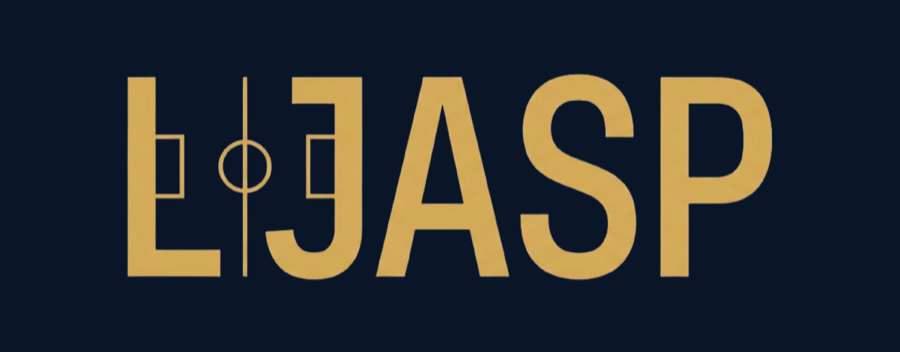
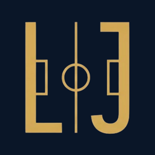

  

  A small independent studio from İstanbul, making software that leaves you in charge. 
  <a href="https://www.ljasp.com">ljasp.com</a> · <a href="mailto:info@ljasp.com">info@ljasp.com</a>

---

### What we make

<table>
  <tr>
    <td width="96" align="center"></td>
    <td>
      <strong><a href="https://github.com/LJASP-studio/Cumba">Cumba</a></strong> · macOS · open source (MIT) 
      Turns the MacBook notch into a panel: a mini player for whatever plays, Claude Code and Codex progress and approvals, widgets in tabs, and themes. 
      <a href="https://github.com/LJASP-studio/Cumba/releases/latest">Download</a> · <a href="https://github.com/LJASP-studio/Cumba#readme">Read more</a>
    </td>
  </tr>
  <tr>
    <td width="96" align="center"></td>
    <td>
      <strong><a href="https://www.ljasp.com">LJASP</a></strong> · Web · Turkish, English, Spanish, French 
      A deterministic football management simulation. Your calls, your match: the engine plays out every decision the same way each time. The studio is named after it. 
      <a href="https://www.ljasp.com">Play</a>
    </td>
  </tr>
</table>

### How we build

- **You're in charge.** Our software does what you tell it and asks before it changes anything of yours.
- **No telemetry.** Nothing is collected about how you use our apps. Anything that goes online is listed in its README.
- **The engine decides.** Results come from rules you can follow. Where AI appears, it explains, it doesn't decide.
- **In your language.** Every product ships in more than one language, Turkish included.

### The name

LJASP is made of the first letters of the word for *the boss* (the one on the touchline who makes the calls) in several languages.

### Say hello

Questions, ideas and bug reports go to each project's Issues. For anything else, write to [info@ljasp.com](mailto:info@ljasp.com).

Run by [Muaz Furkan Kılıç](https://github.com/muazfurkan).
